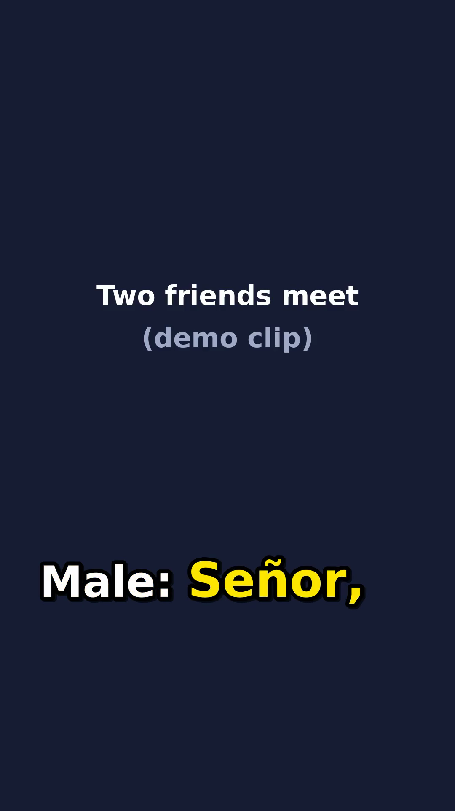
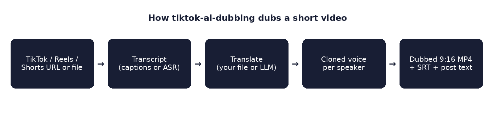

# TikTok AI dubbing: dub TikTok, Reels and YouTube Shorts into any language with cloned voices

**tiktok-ai-dubbing** is a free, open-source command-line tool for TikTok AI dubbing. Give it a TikTok, Instagram Reels, YouTube Shorts or X video URL (or a local file) and a target language, and it writes a 9:16 dubbed MP4 in which every speaker keeps their own cloned voice, with word-highlight captions placed inside the platform safe zones, a translated SRT and a ready-to-paste post caption with hashtags. No GPU needed.



Hear and watch a real result (English male + female lines dubbed to Spanish): [`examples/tiktok-ai-dubbing-spanish-demo/dubbed-short.es.mp4`](examples/tiktok-ai-dubbing-spanish-demo/dubbed-short.es.mp4) · [mp3](examples/tiktok-ai-dubbing-spanish-demo/dubbed-voice.es.mp3) · [srt](examples/tiktok-ai-dubbing-spanish-demo/captions.es.srt) · [post text](examples/tiktok-ai-dubbing-spanish-demo/post.es.txt)



## Quick start

```bash
# 1. Voice engine: install https://miragea.ai/skills/miragea-audio/install.md and export MIRAGEA_API_KEY
export MIRAGEA_API_KEY=...

# 2. Dub a TikTok into English (runs without installing anything)
uvx --from git+https://github.com/RTY2345RR/tiktok-ai-dubbing tiktok-ai-dubbing \
  "https://www.tiktok.com/@creator/video/7300000000000000000" --to en

# Your own translation, two languages, Reels safe zone
tiktok-ai-dubbing reel.mp4 --to es,de --translation reel.es.srt --platform reels
```

Machine translation uses any OpenAI-compatible endpoint (`TRANSLATOR_LLM_BASE_URL`, `TRANSLATOR_LLM_API_KEY`, `TRANSLATOR_LLM_MODEL`; Ollama works) or your own SRT/TXT/JSON translation file. Run `tiktok-ai-dubbing --check` to verify ffmpeg, yt-dlp, the key and the LLM.

## What you get

| File | Use |
|---|---|
| `<title>.<lang>.mp4` | 1080x1920 dubbed video with burned-in word-highlight captions |
| `<title>.<lang>.srt` | captions timed to the dub, for closed-caption upload |
| `<title>.<lang>.ass` | styled captions for CapCut / Premiere / DaVinci |
| `<title>.<lang>.post.txt` | translated post caption, hashtags, credit line |
| `<title>.<lang>.mp3` | the dubbed voice track only |

## Features

- TikTok, Instagram Reels, YouTube Shorts, X and Facebook video URLs (via yt-dlp) or local files
- One cloned voice per speaker, taken from the video itself or from a clip you supply (`--voice "Name=URL|clip text"`)
- Platform safe zones (`--platform tiktok|reels|shorts|all`), caption position, words per caption, font, ALL CAPS
- Blur / crop / pad framing for non-vertical videos
- Time-fitted lines: dubbed speech is sped up (up to `--max-speedup`) to fit its slot, and long lines are flagged
- Resumable: run the same command again, finished steps are reused
- `--subtitles-only`, `--audio-only`, multi-language `--to es,de,ja`

## Comparison

| | tiktok-ai-dubbing | Typical web dubbing app | Manual CapCut workflow |
|---|---|---|---|
| Open source, scriptable | yes | no | no |
| Per-speaker voice cloning | yes | varies | no |
| Safe-zone captions + SRT + post text | yes | partly | by hand |
| Runs in CI / batch | yes | no | no |
| Needs a GPU | no | no | no |

## FAQ

**How do I dub a TikTok video into another language?** Run `tiktok-ai-dubbing "<tiktok url>" --to es`. It downloads the video, transcribes or reads its captions, translates, clones each speaker's voice and renders the 9:16 result.

**Can I translate a TikTok video with AI and keep the original voice?** Yes. Each speaker's voice is cloned from their own audio in the video, so the dub sounds like them.

**Does it work for Instagram Reels and YouTube Shorts?** Yes, pass the URL or the downloaded file. If Instagram or TikTok ask to sign in, set `YTDLP_COOKIES_FROM_BROWSER=chrome`.

**Can I use my own translation?** Yes, `--translation file.srt` (or TXT / JSON).

**Does it add subtitles?** Yes, burned-in word-highlight captions plus a separate SRT and ASS.

## Troubleshooting

- *"Some lines are still too long for their slot"*: shorten those lines in your translation file or raise `--max-speedup`, then rerun.
- *Download fails*: update yt-dlp (`pip install -U yt-dlp`) or use `YTDLP_COOKIES_FROM_BROWSER`.
- *Voice step slow*: each cloned line takes about a minute or two; rerun to resume.

## Related projects

[youtube-dubbing-mcp](https://github.com/RTY2345RR/youtube-dubbing-mcp) · [youtube-video-translator](https://github.com/RTY2345RR/youtube-video-translator) · [multi-speaker-tts](https://github.com/RTY2345RR/multi-speaker-tts) · [miragea-voice-mcp](https://github.com/RTY2345RR/miragea-voice-mcp) · [miragea-agent-skills](https://github.com/RTY2345RR/miragea-agent-skills)

## Credits and licence

MIT. Demo reference voices: CMU ARCTIC (see [CREDITS.md](CREDITS.md)). Voice engine: [Miragea](https://miragea.ai).
